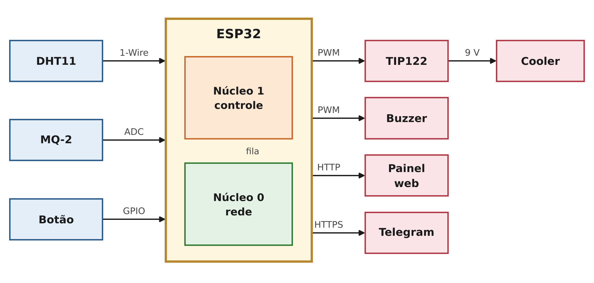
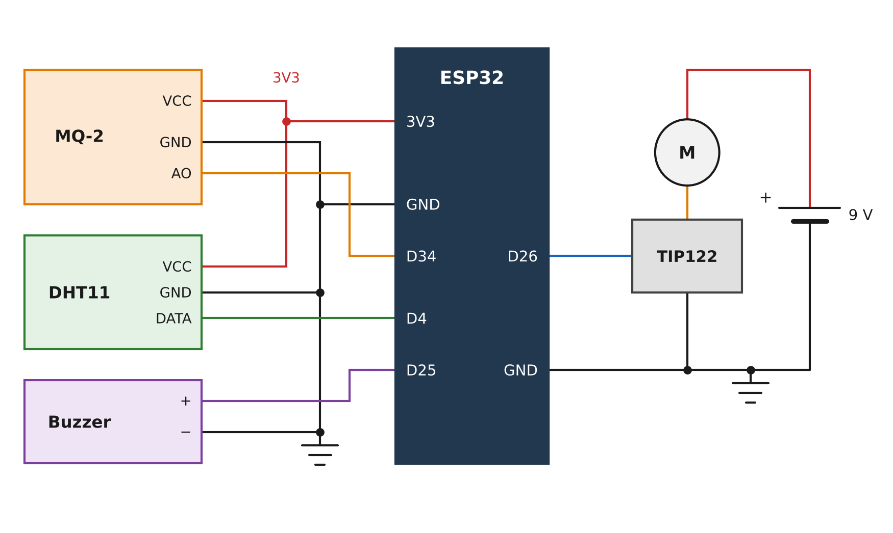

# BoviSense

Protótipo de monitoramento ambiental e controle automático de ventilação para instalações de bovinos leiteiros, construído com ESP32.

O sistema mede temperatura, umidade e resposta a gases combustíveis, calcula o Índice de Temperatura e Umidade (ITU) e ajusta a rotação do ventilador em quatro níveis, no lugar de deixá-lo ligado o tempo todo.

<<<<<<< HEAD
Trabalho A3 da unidade curricular Sistemas de Comunicação e Redes, Engenharia de Software, Centro Universitário de Belo Horizonte (UniBH), 2026. Professor: Dr. Rodrigo Romero.

Autores: Bernardo Luiz Silva Edmundo, Pedro Henrique Esperidião Aureliano, Pedro Lucas dos Santos Kaizer, Rafael Araujo Pace e Stanley Borges Papa.

---
=======
O protótipo é montado e ensaiado em bancada. A maquete do galpão que acompanha o trabalho é expositiva: serve para explicar a aplicação pretendida na apresentação, e não abriga os sensores nem o ventilador.
>>>>>>> e7a837c01fd09e0d8a28afe6bacf92cf0e35c1f8

Trabalho A3 da unidade curricular Sistemas de Comunicação e Redes, Engenharia de Software, Centro Universitário de Belo Horizonte (UniBH), 2026. Professor: Dr. Rodrigo Romero.

Autores: Bernardo Luiz Silva Edmundo, Pedro Henrique Esperidião Aureliano, Pedro Lucas dos Santos Kaizer, Rafael Araujo Pace, Stanley Borges Papa.

## O problema

A ventilação mecânica melhora as condições ambientais do galpão, mas um ventilador que fica ligado em potência máxima consome energia também nas horas em que isso não é necessário. Reduzir a ventilação sem medir nada, por outro lado, prejudica o conforto térmico dos animais e a qualidade do ar.

<<<<<<< HEAD
A primeira versão foi desenvolvida como uma prova de conceito em escala reduzida, montada e ensaiada em bancada. O ESP32 mede temperatura, umidade relativa e a resposta de um sensor de gases, calcula o Índice de Temperatura e Umidade (ITU) e ajusta a rotação do ventilador em quatro níveis, em vez de mantê-lo ligado o tempo todo.

A maquete do galpão que acompanha o trabalho é expositiva: serve para explicar a aplicação pretendida na apresentação e não abriga os sensores nem o ventilador.
=======
A pergunta do trabalho é se um controle adaptativo baseado em medição local reduz o tempo de operação e o consumo da ventilação sem aumentar de forma significativa o período em condições ambientais inadequadas.
>>>>>>> e7a837c01fd09e0d8a28afe6bacf92cf0e35c1f8

## Como funciona

O ESP32 amostra os sensores a cada 2,5 s. Temperatura e umidade passam por média móvel de 4 amostras antes de entrar no cálculo do ITU:

```
ITU = (1,8·T + 32) − (0,55 − 0,0055·UR)·(1,8·T − 26)
```

com T em °C e UR em %. A equação é a de Kelly e Bond (1971), na forma apresentada por Azevedo et al. (2005). Os limiares de 72, 75 e 79 vêm de Armstrong (1994), também apud Azevedo et al. (2005), e separam quatro níveis de ventilação:

| ITU | Nível | Razão cíclica |
|---|---|---|
| abaixo de 72 | 0 | desligado |
| 72 a 75 | 1 | 50 % |
| 75 a 79 | 2 | 75 % |
| acima de 79 | 3 | 100 % |

As transições são assimétricas de propósito. O nível sobe assim que o ITU cruza o limiar, mas só desce depois de 60 s abaixo de (limiar − 2,0) e 60 s de permanência no nível atual. Errar para cima custa energia; errar para baixo custa bem-estar animal. Toda partida do motor começa com um pulso de 1,5 s em 100 % para vencer a inércia.

O MQ-2 entra como índice relativo, IG = R₀/Rs, calculado contra a resistência medida em ar limpo durante os primeiros 60 s depois do aquecimento. Os limiares de gás saem do coeficiente de variação dessa linha de base, e não de valores fixos.

O firmware roda nos dois núcleos: controle e sensores no núcleo 1, Wi-Fi e Telegram no núcleo 0. Uma queda de rede não atrasa o acionamento do ventilador.

## Ligações

| Componente | Terminais | Onde liga |
|---|---|---|
| DHT11 | + / − / OUT | 3V3 / GND / D4 |
| MQ-2 | VCC / GND / AO / DO | 3V3 / GND / D34 / não ligar |
| Buzzer piezo | + / − | D25 / GND |
| TIP122 | B / C / E | resistor de 1 kΩ para D26 (e 10 kΩ da base ao GND) / negativo do cooler / GND |
| Cooler | + / − / tacômetro | positivo da bateria 9 V / coletor do TIP122 / isolar |
| 1N4007 | faixa / outra perna | positivo do cooler / negativo do cooler |

O MQ-2 vai no 3V3, não no VIN. A saída AO acompanha a tensão de alimentação, e com 5 V ela passa do limite de 3,3 V do conversor A/D do D34. Alimentar o sensor com 3,3 V deixa o aquecedor com cerca de 43 % da potência de catálogo, o que está declarado como limitação no artigo.

<<<<<<< HEAD
- monitorar temperatura e umidade relativa do ambiente;
- monitorar a resposta de sensores relacionados à qualidade do ar;
- desenvolver um controlador baseado em ESP32;
- implementar diferentes níveis de ventilação;
- desenvolver sinalização local por painel web e alertas remotos pelo Telegram;
- registrar dados ambientais e operacionais;
- implementar estados de segurança em caso de falha;
- comparar diferentes estratégias de ventilação;
- avaliar o tempo de operação e o esforço de acionamento da ventilação, base para a estimativa do consumo energético;
- desenvolver uma arquitetura que possa futuramente ser escalada para instalações reais.

---

## Funcionamento



O ESP32 amostra os sensores a cada 2,5 s. A temperatura e a umidade passam por média móvel de quatro amostras antes do cálculo do ITU:

```
ITU = (1,8·T + 32) − (0,55 − 0,0055·UR)·(1,8·T − 26)
```

em que T é a temperatura do ar, em °C, e UR é a umidade relativa, em %. A equação é a de Kelly e Bond (1971), na forma apresentada por Azevedo et al. (2005). Os limiares de 72, 75 e 79, de Armstrong (1994), também apud Azevedo et al. (2005), separam quatro níveis de ventilação:

| ITU | Nível | Razão cíclica |
|---|---|---|
| abaixo de 72 | 0 | desligado |
| de 72 a 75 | 1 | 50 % |
| de 75 a 79 | 2 | 75 % |
| a partir de 79 | 3 | 100 % |

A subida de nível é imediata quando o ITU atinge o limiar. A descida, de um nível por vez, ocorre somente depois de 60 s com o ITU abaixo do limiar menos a histerese de 2,0 unidades e de 60 s de permanência no nível atual. A assimetria é proposital: errar para cima custa energia, enquanto errar para baixo prejudica o conforto térmico dos animais. Toda partida do motor começa com um pulso de 1,5 s a 100 % para vencer a inércia.

O MQ-2 é tratado como índice relativo, IG = R₀/Rs, calculado em relação à resistência medida em ar limpo durante 60 s, logo após o aquecimento do sensor. Os limiares de gás são definidos a partir do coeficiente de variação dessa linha de base, e não por valores fixos. O nível aplicado ao ventilador é o maior entre o nível pedido pelo ITU e o pedido pelo índice de gases.

O firmware usa os dois núcleos do ESP32: amostragem, decisão e acionamento no núcleo 1; Wi-Fi, painel web e Telegram no núcleo 0, com troca de mensagens por fila. Dessa forma, uma falha de rede não atrasa o acionamento do ventilador. Três falhas seguidas de leitura do DHT11 levam ao modo seguro, com o ventilador a 100 %.

O sistema oferece quatro modos, escolhidos pelo painel ou pelo Telegram:

- 0, contínua: ventilador sempre a 100 %, como referência;
- 1, liga-desliga: 100 % quando o ITU atinge 72 ou o índice de gases atinge o primeiro limiar, e desligado abaixo disso, sem histerese;
- 2, adaptativa: os quatro níveis, com histerese e tempo de permanência;
- 3, verificação funcional: a mesma lógica da adaptativa, com limiares no ITU medido na inicialização acrescido de 1, 2 e 3 unidades, para demonstrar as trocas de nível sem aquecer o ambiente.

---

## Componentes e ligações



| Componente | Terminais | Ligação |
|---|---|---|
| DHT11 | + / − / OUT | 3V3 / GND / D4 |
| MQ-2 | VCC / GND / AO / DO | 3V3 / GND / D34 / sem ligação |
| Buzzer piezoelétrico | + / − | D25 / GND |
| TIP122 | B / C / E | resistor de 1 kΩ para D26 (e 10 kΩ da base ao GND) / negativo do cooler / GND |
| Cooler | + / − / tacômetro | positivo da bateria de 9 V / coletor do TIP122 / isolado |
| Diodo 1N4007 | faixa / outro terminal | positivo do cooler / negativo do cooler |

O MQ-2 é alimentado pelo 3V3, e não pelo VIN. A saída AO acompanha a tensão de alimentação e, com 5 V, ultrapassaria o limite de 3,3 V do conversor A/D do D34. Com 3,3 V, o aquecedor do sensor opera com cerca de 44 % da potência de catálogo, o que está declarado como limitação no artigo.

O cooler e a bateria de 9 V não são ligados a nenhum pino do ESP32. A placa fornece 3,3 V e algumas dezenas de miliampères, enquanto o motor exige corrente muito maior; por isso o acionamento é feito pelo TIP122. O GND da bateria e o GND do ESP32 devem estar no mesmo ponto, caso contrário o transistor não chaveia.

---

## Gravação do firmware

Na IDE Arduino:

1. em Preferências, no campo de URLs adicionais de placas, informar `https://espressif.github.io/arduino-esp32/package_esp32_index.json`;
2. no Gerenciador de Placas, instalar esp32 by Espressif Systems (testado na versão 3.3.12);
3. em Gerenciar Bibliotecas, instalar DHT sensor library, Adafruit Unified Sensor e ArduinoJson 7.x;
4. copiar `firmware/segredos.exemplo.h` para `firmware/segredos.h`;
5. abrir `firmware/firmware.ino`, selecionar a placa ESP32 Dev Module e gravar.

O `segredos.h` pode ficar em branco: a rede Wi-Fi e as credenciais do Telegram podem ser configuradas pelo painel e ficam gravadas na memória não volátil do ESP32. Quando o `segredos.h` é editado e o firmware é gravado de novo, o valor novo substitui o que estava salvo pelo painel; sem edição, vale o que foi salvo pelo painel.

O programa fica em `bovisense.cpp`, e não no `.ino`. A IDE pré-processa apenas arquivos `.ino`, e esse pré-processamento quebra a página HTML embutida no código. O `.ino` precisa ter o mesmo nome da pasta que o contém, por isso se chama `firmware.ino`.

Caso apareça a mensagem "Sketch too big", selecionar em Ferramentas, Partition Scheme, a opção Minimal SPIFFS (1.9MB APP).

O `segredos.h` preenchido nunca deve ser publicado. Se um token de bot do Telegram já apareceu em captura de tela, slide, grupo ou commit, ele deve ser revogado no @BotFather: `/mybots`, o bot, API Token, Revoke.

Para gravar sem o transistor montado, basta usar `#define SEM_ATUADOR 1` no início do `bovisense.cpp`. O sistema mede, decide, registra e alerta, mas apenas recomenda o nível, sem acionar o motor. Serve para validar sensores, painel e Telegram, e não produz dados de ensaio.

---

## Painel local e Telegram

Depois da gravação, o Monitor Serial a 115200 mostra o autoteste (pressionar EN para reiniciar). O ESP32 cria a rede Wi-Fi `BoviSense`; com o celular conectado a ela, o painel fica em `http://192.168.4.1`.

O painel tem duas vistas. A de operação abre por padrão e mostra ITU, temperatura, umidade, gases, nível de ventilação e o gráfico dos últimos 10 minutos. A vista técnica traz as estratégias, as métricas do ensaio, a calibração dos sensores e a configuração de rede, além do download do registro em CSV.

Os endereços que alteram o estado do sistema (`/modo`, `/novo`, `/simular`, `/parar`, `/wifi`, `/tg`, `/cal/*`) só aceitam requisições vindas da rede do próprio aparelho (192.168.4.x). A leitura é livre.

Para receber os alertas, basta informar o token do bot no `segredos.h` ou no painel. Com o ESP32 ligado e conectado à internet, qualquer mensagem enviada ao bot pelo Telegram vincula aquele chat: o bot responde "Pronto! Este chat foi vinculado" e grava o número do chat na memória do ESP32, que se mantém após uma nova gravação do firmware. A vinculação automática só ocorre enquanto não há chat válido configurado; depois disso, quem escrever ao bot recebe apenas o próprio número. O `TG_CHAT_ID` pode ficar vazio. O número antes dos dois-pontos do token é o identificador do próprio bot, não do usuário, e o firmware o ignora.

Comandos do bot:

- `/status`: leituras atuais;
- `/relatorio`: métricas do ensaio;
- `/modo 0..3`: troca a estratégia;
- `/simular` e `/parar`: emergência de teste de 60 s;
- `/novoensaio`: zera as métricas;
- `/calibrar_gas`: refaz a linha de base do MQ-2.

---

## Ensaios e resultados

Os resultados abaixo estão detalhados no artigo e podem ser reproduzidos a partir dos registros e scripts da pasta `dados/`.

- **Verificação em computador:** as 14 verificações da pasta `testes/` reproduziram o comportamento especificado. Em uma hora de sinal sintético de ITU, a estratégia liga-desliga comutou 185 vezes e a adaptativa, 2 vezes; o tempo equivalente de plena carga foi de 32,8 min na adaptativa, 43,3 min no liga-desliga e 60 min na contínua.
- **Sessão inicial de bancada:** 226 amostras, com temperatura entre 28,0 e 28,9 °C e ITU entre 76,0 e 77,2. Todas as verificações de conformidade foram atendidas.
- **Ensaio por estratégia em ar ambiente (16/11/2026):** 958 amostras de operação, com ITU entre 75,5 e 76,6. O nível aplicado seguiu a regra da estratégia ativa em todas as amostras; sobre as mesmas leituras, a adaptativa operou a 75 %, contra 100 % da contínua e da liga-desliga.
- **Ensaios com perturbação aplicada ao DHT11 (16 e 17/11/2026):** a temperatura foi elevada com o ferro de solda e a umidade, com ar expirado. As quatro trocas de nível seguiram a regra, dez descidas foram corretamente adiadas pela histerese e uma reimplementação independente da regra reproduziu o estágio gravado em todas as 734 amostras. A razão cíclica média da adaptativa foi de 87,5 % e 94,8 %, contra 100 % das estratégias de referência.

O consumo de energia não foi medido. O tempo equivalente de plena carga e a razão cíclica média indicam o esforço de acionamento; convertê-los em energia exige medir a potência do ventilador em cada nível.

---

## Recuperação após reinício

Se o ESP32 reiniciar sozinho (pânico de software, watchdog ou queda de tensão), o firmware retoma o controle em poucos segundos, na mesma estratégia e com a linha de base do MQ-2 guardada na memória do RTC, sem repetir o aquecimento do sensor: nesses reinícios o 3V3 não é desligado e o aquecedor do MQ-2 permanece quente. Ao ligar a placa ou pressionar EN, o aquecimento completo é feito normalmente. O motivo do reinício aparece no Monitor Serial e no Telegram.

O único reinício observado nos ensaios (16/11/2026) teve origem no núcleo Arduino-ESP32 3.3.12: na primeira consulta de DNS, `NetworkManager::hostByName` limpa o cache do lwIP sem a trava do núcleo TCP/IP e, se o SNTP estiver resolvendo o servidor de hora nesse instante, o ESP32 aborta (`assert failed: udp_new_ip_type`). O firmware passou a fazer essa primeira consulta antes de iniciar o SNTP.

---

## Estrutura do repositório

```
artigo/                 artigo em ABNT (.docx e .pdf)
dados/                  registros de bancada e scripts de análise
docs/figuras/           figuras do artigo e scripts que as geram
firmware/               programa do ESP32 (abrir esta pasta na IDE Arduino)
  firmware.ino            instruções de uso
  bovisense.cpp           programa completo, 1649 linhas
  segredos.exemplo.h      modelo em branco, copiar para segredos.h
modelos/                modelagem 3D das cases, do galpão e dos suportes (.3mf)
referências/            levantamento bibliográfico em ABNT
testes/                 testes da lógica de controle, executados no computador
```

O firmware compila sem avisos no núcleo Arduino-ESP32 3.3.12, ocupando 87 % da área de programa no esquema de partição padrão (58 % em Minimal SPIFFS) e 27 % da memória RAM em variáveis globais.

---

## Limitações

- o MQ-2 não mede ppm: é um sensor resistivo de baixa seletividade, sem calibração com gás padrão, e o sistema informa apenas um índice relativo ao ar limpo medido na inicialização;
- o DHT11 tem exatidão de ±2 °C e ±5 % de umidade relativa, o que propaga para o ITU uma incerteza da ordem de ±2 unidades; um DHT22 ou SHT31 reduziria essa incerteza;
- o consumo de energia não foi medido, o que exigiria um sensor de corrente como o INA219;
- os ensaios são de bancada e em malha aberta: o ventilador não altera o ar em que os sensores estão, e nenhum resultado é extrapolado para galpões reais, onde o escoamento de ar, o volume e a carga térmica animal são de outra ordem;
- o cliente HTTPS usa `setInsecure()`, sem validação de certificado, o que é aceitável para um protótipo em rede local, mas não para uma instalação real.

---

## Licença

MIT, conforme o arquivo [LICENSE](LICENSE). As referências bibliográficas pertencem a seus respectivos autores e editoras.
=======
O cooler e a bateria de 9 V não encostam em nenhum pino do ESP32. A placa entrega 3,3 V e algumas dezenas de miliampères; o motor precisa de muito mais, e é para isso que existe o TIP122. O GND da bateria e o GND do ESP32 precisam estar no mesmo ponto, ou o transistor não chaveia.

## Gravando o firmware

Na IDE Arduino:

1. Preferências, em URL adicional de placas: `https://espressif.github.io/arduino-esp32/package_esp32_index.json`
2. Gerenciador de Placas: esp32 by Espressif Systems (testado na versão 3.3.12).
3. Gerenciar Bibliotecas: DHT sensor library, Adafruit Unified Sensor, ArduinoJson 7.x.
4. Copie `firmware/segredos.exemplo.h` para `firmware/segredos.h`. Ele pode ficar em branco: a rede Wi-Fi e as credenciais do Telegram são configuradas pelo painel e ficam gravadas na memória não volátil do ESP32.
5. Abra `firmware/firmware.ino`, selecione ESP32 Dev Module e grave.

O programa fica em `bovisense.cpp`, não no `.ino`. A IDE pré-processa apenas arquivos `.ino`, e esse pré-processamento quebra a página HTML embutida no código. O `.ino` precisa ter o mesmo nome da pasta que o contém, e é por isso que ele se chama `firmware.ino`: é uma exigência da IDE, não uma escolha de estilo.

Se aparecer "Sketch too big", vá em Ferramentas, Partition Scheme, e escolha Minimal SPIFFS (1.9MB APP).

Nunca publique o `segredos.h` preenchido. Se algum token de bot do Telegram já apareceu em print, slide, grupo ou commit, revogue no @BotFather: `/mybots`, o bot, API Token, Revoke.

## Painel e Telegram

Depois de gravar, abra o Monitor Serial a 115200 e aperte EN para ver o autoteste. O ESP32 cria a rede Wi-Fi `BoviSense`; conecte o celular nela e abra `http://192.168.4.1`.

O painel tem duas vistas. A de operação abre por padrão e mostra ITU, temperatura, umidade, gases, nível de ventilação e o gráfico dos últimos 10 minutos. A vista técnica, a um clique, traz as três estratégias, as métricas do ensaio, a calibração dos sensores e a configuração de rede.

Os endereços que mudam estado (`/modo`, `/novo`, `/simular`, `/parar`, `/wifi`, `/tg`, `/cal/*`) só aceitam requisição vinda de 192.168.4.x, ou seja, de quem está na rede do próprio aparelho. Leitura é livre.

Comandos do bot: `/status`, `/relatorio`, `/simular`, `/parar`, `/modo 0..3`, `/novoensaio`, `/calibrar_gas`, `/ligar`.

## Conteúdo

```
firmware/               programa do ESP32 (abra esta pasta na IDE Arduino)
  firmware.ino            aba de instruções
  bovisense.cpp           programa completo, 1334 linhas
  segredos.exemplo.h      modelo em branco, copie para segredos.h
figuras/                figuras do artigo
modelos/                modelagem 3D da case, do galpão e dos suportes (.3mf)
referências/            levantamento bibliográfico, 22 obras em ABNT
```

## Situação

O firmware compila sem avisos no núcleo Arduino-ESP32 3.3.12, ocupando 86 % da área de programa no esquema de partição padrão (57 % em Minimal SPIFFS) e 27 % da memória RAM. A lógica de controle tem testes que rodam no computador, fora do ESP32.

Sensores, painel, Telegram e o estágio de potência com TIP122 estão montados. Os ensaios comparativos entre as três estratégias de ventilação ainda não foram executados, e é deles que sai a tabela de resultados do artigo.

Para gravar sem o transistor montado, use `#define SEM_ATUADOR 1` no início do `bovisense.cpp`. O sistema mede, decide, registra e alerta, mas apenas recomenda o nível em vez de acionar o motor. Serve para validar sensores, painel e Telegram, e não produz dados de ensaio.

## Limitações

O MQ-2 não mede ppm. É um sensor resistivo de baixa seletividade, sem calibração com gás padrão. O que o sistema informa é um índice relativo ao ar limpo medido na inicialização, e é assim que o artigo o trata.

O DHT11 tem exatidão de ±2 °C e ±5 % de umidade relativa, o que propaga para o ITU uma incerteza da ordem de ±2 unidades. Trocar por DHT22 ou SHT31 reduz isso em cerca de quatro vezes.

O consumo de energia é estimado a partir da razão cíclica e da potência nominal do ventilador, não medido. Medir exigiria um sensor de corrente como o INA219.

Os ensaios são de bancada, não de galpão. O protótipo demonstra que o controlador mede, decide e aciona conforme a norma de ITU adotada, e não que a mesma lógica produza o mesmo efeito numa instalação comercial, onde o escoamento de ar, o volume e a carga térmica animal são de outra ordem. Nenhum resultado obtido aqui é extrapolado.

O cliente HTTPS usa `setInsecure()`, sem validação de certificado. Para um protótipo em rede local é aceitável, e está registrado como limitação no artigo.

## Licença

MIT, veja [LICENSE](LICENSE). As referências bibliográficas pertencem a seus respectivos autores e editoras.
>>>>>>> e7a837c01fd09e0d8a28afe6bacf92cf0e35c1f8
